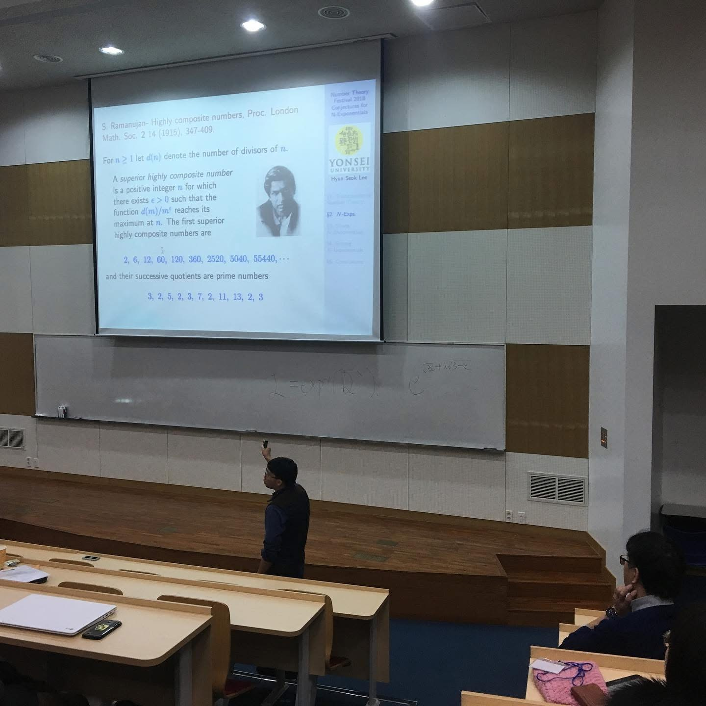

# Between Proof and Prose

> *"I study transcendental number theory, teach students who love mathematics, and write about the moments in between."*

> **Contact:** luciasconstant@gmail.com

> **Research Interests** :
>  * **Primary Focus:** Transcendental Number Theory — Schanuel's Conjecture, Three Exponentials Conjecture, Constant Problem
>  * **Special Functions & Combinatorics:** Degenerate Bell, Fubini, and Bernoulli polynomials.
>  * **Interdisciplinary:** The intersection of rigorous mathematical logic and the lyrical beauty found in Romanticism literature and visual arts.

---

---

---

---

---
