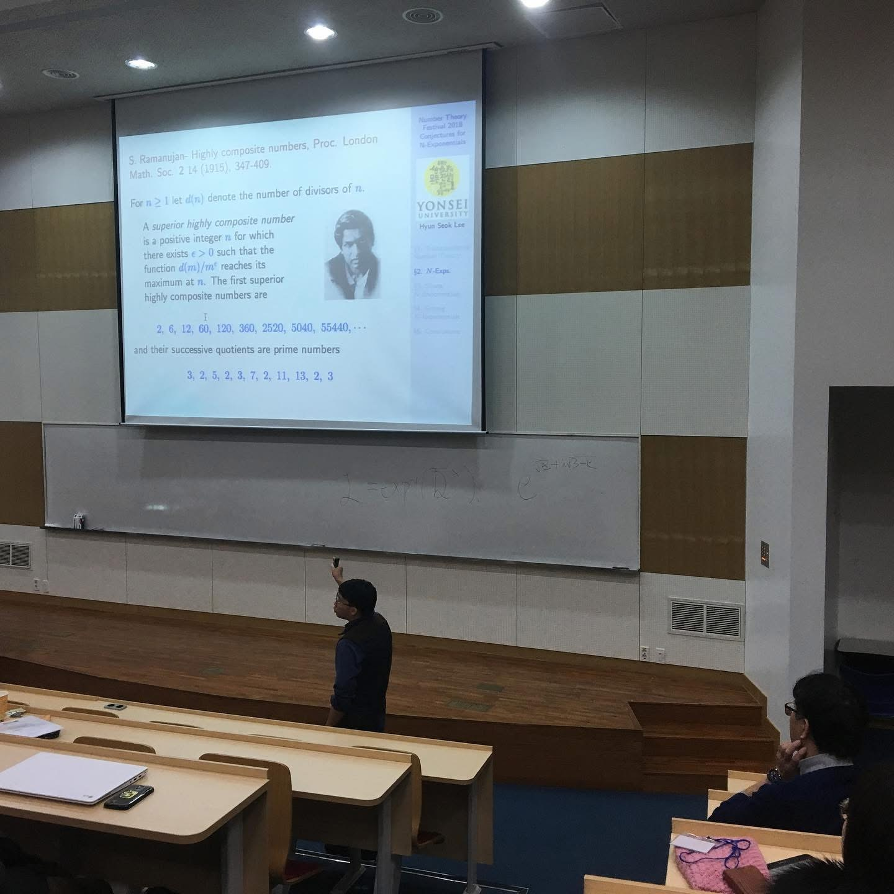

# 수학자의 여백

> *"초월수론을 연구하고, 수학을 사랑하는 학생들과 함께 공부하며, 그 사이의 크고 작은 순간들을 이 공간에 기록합니다."*

관심사 : 자연풍경, 음악, 그리고 생각들.

> **연락처:** luciasconstant@gmail.com

> **주요 연구 관심사**
>  * **초월수론 (Transcendental Number Theory):** Schanuel 추측, Three Exponentials 추측, Constant Problem을 중심으로 연구합니다.
>  * **특수 다항식 및 조합론:** 퇴화 벨, 푸비니, 베르누이 다항식의 성질과 조합론적 항등식을 연구합니다.
>  * **학문간 융합:** 수학의 엄밀한 논리와 낭만주의 문학, 시각 예술이 공유하는 구조적 아름다움을 탐구합니다.

---

---

---

---

---
